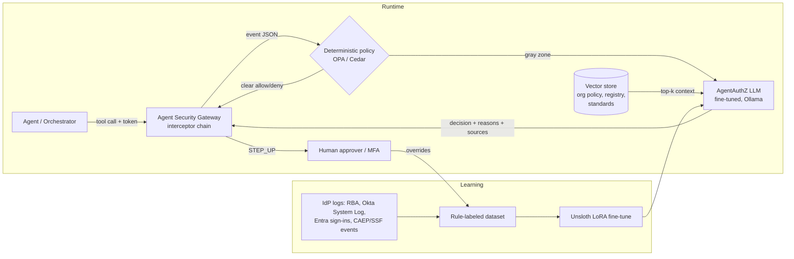

# AgentAuthZ Analyst

**A small, local, domain-specialized LLM that makes and explains authentication and authorization decisions for humans *and* the AI agents acting on their behalf.** It returns `ALLOW / STEP_UP / DENY` with a risk score, reasons, the standards applied, and the policy documents it relied on.

> Fine-tuned Llama-3.2-3B (Unsloth LoRA) → served by Ollama (GGUF) → augmented with retrieval over org policy (LangFlow + Chroma + nomic-embed-text).

The pipeline is fine-tune → deploy → RAG. The focus is **Identity & Access Management for AI agents** (user ↔ agent identity and permissions), with *human-in-the-loop* approval and *agent action models (Ask / Act / Verify & Act)* as secondary topics.

---

## 1. The problem

Identity providers already score *human* logins with risk-based authentication. An AI agent, though, logs in once and then makes hundreds of tool calls on a user's behalf: reading customer records, sending email, releasing payments. Each call raises questions:

- **Who is acting?** Is it delegation (an RFC 8693 `act` claim) or silent impersonation?
- **Can it do this?** Are the agent's scopes within what the user delegated, and within what the user is entitled to? Is the token's audience this MCP server?
- **Should a human confirm?** Irreversible actions call for *Verify & Act*.
- **Is the agent still allowed to exist?** Revocation lists and IdP caches can lag.

Today these checks are hand-written per team, and nothing explains *why* a call was blocked. AgentAuthZ is the decision-and-explanation brain that an agent gateway or security library interceptor can call per tool invocation.

## 2. Evidence this is a real, growing problem

| Signal | Evidence |
|---|---|
| Credentials remain the #1 way in | Verizon **2025 DBIR**: credential abuse was the most common initial access vector (**22%** of breaches), across 12,195 confirmed breaches. [Verizon](https://www.verizon.com/about/news/2025-data-breach-investigations-report) |
| Non-human identities dominate | CyberArk 2025 Identity Security Landscape: **82 machine identities per human**, and 68% of organizations lack security controls for AI. [VentureBeat](https://venturebeat.com/security/machine-identities-outnumber-humans-82-to-1-legacy-iam-cant-keep-up) |
| Major IdPs are building agent identity now | **Microsoft Entra Agent ID** puts agents in the directory and applies **Conditional Access and Identity Protection to agents**. That is exactly the risk decision this project models. [Microsoft](https://techcommunity.microsoft.com/blog/microsoft-entra-blog/announcing-microsoft-entra-agent-id-secure-and-manage-your-ai-agents/3827392) |
| Standards are converging on delegated tokens | The **OpenID Foundation** whitepaper *Identity Management for Agentic AI* (Oct 2025) names token-exchange delegation a foundational building block. [OpenID](https://openid.net/new-whitepaper-tackles-ai-agent-identity-challenges/) The IETF draft **OAuth for AI agents on behalf of user** adds `requested_actor` / `actor_token`. [IETF](https://datatracker.ietf.org/doc/html/draft-oauth-ai-agents-on-behalf-of-user-02) |
| Tool protocols require it | The **MCP Authorization** spec makes MCP servers OAuth resource servers that must validate audience and must not pass tokens through. [MCP](https://modelcontextprotocol.io/specification) |
| OWASP names the risk | **LLM06:2025 Excessive Agency**: too much functionality, permission, or autonomy. [OWASP](https://genai.owasp.org/llmrisk/llm062025-excessive-agency/) |
| RBA works at scale for humans | Wiefling et al. (ACM TOPS 2022) studied 33M logins and 3.3M users. RBA blocked more than 99% of targeted attackers while rarely asking legitimate users to re-authenticate. [ACM](https://dl.acm.org/doi/10.1145/3546069) |

**Why the approach scales:** RBA for humans is proven in production. Agents need the same thing per action, with richer signals (delegation chain, scopes, audience, reversibility, data sensitivity). The model emits structured decisions plus citations. A gateway can therefore enforce them, and an auditor can trace each one back to policy.

## 3. Architecture



| Knowledge | Where it lives | Example |
|---|---|---|
| **Parametric** (in the weights, from fine-tuning) | Decision patterns, output schema, IAM vocabulary | "no `act` claim means impersonation → DENY"; always valid JSON |
| **Contextual** (retrieved at query time) | Org-specific, fast-changing facts | "invoice-bot-07 was revoked on 2026-09-28"; "PII limit is 50 records" |

## 4. Data (1,410 rows: 1,269 train / 141 held-out)

| Source | Rows | What |
|---|---|---|
| `rba_login` | 450 | Human logins from the RBA dataset (Wiefling et al., 33M attempts, Norwegian SSO; the authors synthesized the values to preserve real distributions; CC BY 4.0). Per-user history (new country/ASN/device, failures in the last 24h) is replayed in time order. All 140 ground-truth account takeovers are included. |
| `synthetic_agent` | 750 | Agent token-exchange / MCP tool-call events covering 15 fault types: revoked agent, missing `act`, wrong actor, audience mismatch, scope escalation, role exceeded, replay, deep chain, old token, irreversible without approval, bulk PII, geo, odd hour, stale MFA |
| `synthetic_agent_rag` | 210 | Same events plus a retrieved **CONTEXT** block with *randomized* policy values. The model learns to read and cite context instead of memorizing it. |

Labels come from a transparent rule engine (`data/build_dataset.py`), so every target is reproducible and auditable. Login labels use **only signals observable at login time**. The dataset's ground-truth account-takeover flag is never a label; it measures the rules instead. **The rule baseline catches 103 of 140 real account takeovers (74%: 76 DENY, 27 STEP_UP)**, and the 37 it misses are the case for learned risk models. Eval is a stratified held-out 10% (141 rows); training is 1,269 rows. Every target starts with a `checks` trace (one verdict per signal) before the decision, so the model must evaluate each signal instead of pattern-matching the answer template. That change took held-out agent accuracy from 51% (v1) to 93% (v2); see §5.

## 5. Results

Held-out set: 141 events never seen in training. Reproduce with `python3 eval/run_compare.py --heldout --three-tier`; the full output is in [eval/results/summary.txt](eval/results/summary.txt).

| Model (served by Ollama, q4_k_m) | Accuracy | Macro-F1 | Valid JSON | Logins | Agent | Agent + policy context | s/event (M1, 8 GB) |
|---|---|---|---|---|---|---|---|
| Base `llama3.2:3b` | 33% | 0.21 | 97% | 16/45 | 25/75 | 5/21 | 10.9 |
| Fine-tuned v1 (answer only) | 55% | 0.52 | 94% | 33/45 | 38/75 | 7/21 | 4.6 |
| **Fine-tuned v2 (checks → answer)** | **96%** | **0.96** | 98% | **45/45** | **70/75** | **20/21** | 6.9 |
| v2 + deterministic guard | **99%** | **0.99** | 98% | | | | |

**Three-tier comparison** (same questions; ✓ = matches the rule engine with Acme policy):

| Q | Expected | Base | Fine-tuned | Fine-tuned + RAG | Source cited |
|---|---|---|---|---|---|
| Q1 human login, new country/ASN after failures | STEP_UP | ALLOW ✗ | STEP_UP ✓ | STEP_UP ✓ | – |
| Q2 payment.release, no `act`, escalated scope | DENY | ALLOW ✗ | STEP_UP ✗ (guard → DENY ✓) | DENY ✓ | rfc8693_token_exchange.md |
| Q3 irreversible email, approval pending | STEP_UP | ALLOW ✗ | STEP_UP ✓ | STEP_UP ✓ | acme_agent_authorization_policy.md |
| R1 revoked agent invoice-bot-07 | DENY | ALLOW ✗ | ALLOW ✗ | **DENY ✓** | acme_agent_registry.md |
| R2 80 PII records (Acme limit 50) | STEP_UP | ALLOW ✗ | ALLOW ✗ | **STEP_UP ✓** | acme_agent_authorization_policy.md |
| R3 runtime in DE (approved region) | ALLOW | ALLOW (says ALLOW to everything) | STEP_UP ✗ | **ALLOW ✓** | acme_agent_authorization_policy.md |

What we learned along the way:
1. **v1 → v2: make the model show its work.** v1 learned the answer *template* (loss 0.023) but defaulted to ALLOW on agent attacks: 4 of 17 agent DENY cases right in a spot check. v2 writes a `checks` object (one verdict per signal) *before* the decision, with 2.5× more agent data, and agent accuracy rose from 51% to 93%.
2. **Quantization costs accuracy on hard cases.** In Colab, v2 at full precision denied Q2. The 4-bit GGUF reports `act_claim: "missing"` but under-decides to STEP_UP. Even the exact training prompt sent raw reproduces it, so the cause is quantization, not the prompt.
3. **"LLM explains, code enforces."** A 20-line escalate-only guard over the model's own `checks` fixes Q2 and takes held-out accuracy from 96% to 99%, with 1 under-decision left out of 141.
4. **Without retrieval, the model invents policy.** Asked "is that within our bulk data policy?", the fine-tuned model alone answered "exceeds the **10**-record bulk data policy" and cited nothing. Acme's real limit is 50. RAG replaced the invention with the real number and a citation.

## 6. Path to production

| Stage | Change | Why |
|---|---|---|
| 1. Service | Wrap as a FastAPI policy decision point. The Agent Security Library's interceptor calls `POST /decide` before each tool call. | Drops into any orchestrator |
| 2. Real signals | Ingest Okta System Log, Entra sign-in logs, and OpenID Shared Signals (CAEP) session-revoked events. Replace synthetic agent events with gateway traces. | Ground truth from production |
| 3. Guardrails | A deterministic engine (OPA or Cedar) stays authoritative for hard rules. The LLM handles gray-zone STEP_UP triage and explanations. Fail closed on invalid output. | LLMs aren't a sole enforcement point |
| 4. Retrieval at scale | Swap Chroma for pgvector or a managed vector DB. Auto-sync the corpus from the policy-as-code repo and agent registry. Add a metadata filter by tenant. | Fresh policy without retraining |
| 5. Feedback loop | Human approver overrides become new labeled rows. Re-fine-tune periodically. Track accuracy, false-deny rate, and latency per release. | Model improves with use |
| 6. Latency | Keep a 1–3B quantized model on CPU or GPU next to the gateway. Cache decisions per (agent, tool, scope-set). Only gray-zone calls hit the LLM. | Per-call budget in the tens of ms |

**Limitations (stated honestly):** citation and wording are imperfect. In Q2 the model also listed an irrelevant registry file. In LangFlow, the R2/R3 reasons paraphrase the policy loosely ("limit in the agent's token") even though the decision, checks and cited file are correct. agent events are synthetic, and the RBA values are synthesized from real distributions. Rule-generated labels teach the model to imitate the rules, so its value lies in explanation, generalization to messy inputs, and policy-grounded reasoning, not in replacing the rules. A 3B model can hallucinate, so production keeps deterministic enforcement in front of it.

## 7. Repo map

```
data/build_dataset.py               dataset builder (RBA sampler + agent generator + rule engine)
data/{train,eval}.jsonl             chat-format training data (1,269 / 141)
data/{rba_sample,agent_events}.csv  human-readable previews
notebooks/finetune_unsloth.ipynb    Colab v2: LoRA fine-tune, base-vs-FT compare, GGUF export (executed)
notebooks/finetune_unsloth_v1_executed.ipynb   v1 run, kept for the v1 to v2 comparison
deploy/Modelfile                    Ollama model definition (GGUF itself is git-ignored, 2 GB)
rag/corpus/                         retrievable knowledge (Acme policy + registry, RFC/MCP/OWASP/NIST/RBA summaries)
rag/langflow_agentauthz.json        exported LangFlow flow (LangFlow Desktop 1.12)
rag/LANGFLOW_BUILD.md               the same flow, component by component
rag/sync_corpus_to_langflow.sh      copies the corpus into LangFlow's allowed root
rag/rag_pipeline.py                 code version of the RAG pipeline + deterministic guard (stdlib + Ollama API)
eval/run_compare.py                 base vs v1 vs v2 (+guard) held-out eval; three-tier comparison
eval/make_questions.py              regenerates the comparison and RAG questions with ground truth
eval/questions.md                   the 3 comparison + 3 RAG questions
eval/results/summary.txt            latest evaluation output
docs/reflection.md                  parametric vs contextual knowledge
docs/brief_reflection_notes.md      one-page version of the reflection
docs/architecture.html              architecture diagrams and a walkthrough (open in a browser)
docs/screenshots/                   screenshots of each stage (v1/ holds the first run)
```

## Screenshots

| Stage | Screenshot or artifact |
|---|---|
| Dataset loaded and visible | `docs/screenshots/01_dataset.png` |
| Unsloth training with loss | `docs/screenshots/02_training_loss.png` (loss 2.100 → 0.003, 318 steps, T4) |
| Same 3 questions: base vs fine-tuned | `docs/screenshots/03_q1_base_vs_ft.png`, `04_q2_base_vs_ft.png`, `05_q3_base_vs_ft.png` (side by side) |
| Ollama deployment | `docs/screenshots/09_ollama_run.png` |
| RAG pipeline | `docs/screenshots/10_langflow_canvas.png` + `rag/langflow_agentauthz.json` + `rag/rag_pipeline.py` |
| 3 RAG answers naming a source document | `docs/screenshots/11_rag_q1.png`, `12_rag_q2.png`, `13_rag_q3.png` |
| Reflection | `docs/reflection.md` |
| Notebook / flow / code / metrics | `notebooks/*.ipynb`, `rag/langflow_agentauthz.json`, `rag/rag_pipeline.py`, `docs/screenshots/14_eval_table.png` |

## 8. Build and run

The trained dataset, eval questions and saved results are committed, so you can start at any step. Only the fine-tuned model file (GGUF, about 2 GB) is not in the repo: step 2 creates it.

### Prerequisites

| Need | For | Notes |
|---|---|---|
| Python 3.9+ | all scripts | Standard library only; no `pip install` needed |
| [Ollama](https://ollama.com) | serving, RAG, eval | Start the app, or run `ollama serve` |
| Google account + [Colab](https://colab.research.google.com) | fine-tuning (step 2) | Free T4 GPU runtime is enough |
| [LangFlow Desktop](https://www.langflow.org/desktop) | optional visual RAG flow (step 5) | Tested with 1.12 |
| RBA login dataset | optional, rebuilding the data (step 1) | `rba-dataset.csv` from [zenodo.org/records/6782156](https://zenodo.org/records/6782156) (about 9 GB unzipped) |

Tested on an Apple M1 with 8 GB of RAM.

### 1. (Optional) Rebuild the dataset

`data/train.jsonl` and `data/eval.jsonl` are already in the repo. To regenerate them:

```bash
mkdir -p data/raw            # git-ignored
# download rba-dataset.csv from zenodo.org/records/6782156 into data/raw/
python3 data/build_dataset.py --rba data/raw/rba-dataset.csv
```

No RBA file? `python3 data/build_dataset.py --synthetic-only` builds the agent rows only.

### 2. Fine-tune in Colab and download the model

1. Open [Colab](https://colab.research.google.com), choose **File → Upload notebook**, and select `notebooks/finetune_unsloth.ipynb`.
2. Set **Runtime → Change runtime type → T4 GPU**.
3. In the **Files** panel, upload `data/train.jsonl` and `data/eval.jsonl`.
4. Choose **Runtime → Run all**.
5. When the last cell prints `agentauthz-q4_k_m.gguf`, download that file from the Files panel into `deploy/`.

### 3. Serve with Ollama

```bash
ollama pull llama3.2:3b          # base model, for comparison
ollama pull nomic-embed-text     # embeddings for RAG
cd deploy && ollama create agentauthz -f Modelfile && cd ..
ollama run agentauthz            # paste an event from eval/questions.md to try it
```

### 4. Run the RAG pipeline (code version)

```bash
python3 rag/rag_pipeline.py --build                 # index rag/corpus into rag/.index.json (git-ignored)
python3 rag/rag_pipeline.py --question R1           # R1, R2 or R3 from eval/rag_questions.json
python3 rag/rag_pipeline.py --event '<event json>'  # any event
```

Set `OLLAMA_HOST` or `AGENTAUTHZ_MODEL` to point at a different Ollama server or model name.

### 5. (Optional) Build the RAG flow in LangFlow

Follow [rag/LANGFLOW_BUILD.md](rag/LANGFLOW_BUILD.md), or import `rag/langflow_agentauthz.json` and set the two paths it names.

### 6. Evaluate

```bash
python3 eval/run_compare.py --report                                         # print the saved results
python3 eval/run_compare.py --three-tier                                     # Q1–Q3 + R1–R3: base vs fine-tuned vs fine-tuned + RAG
python3 eval/run_compare.py --heldout --models llama3.2:3b,agentauthz       # 141 held-out events
```

Held-out results are cached per model in `eval/results/heldout_<model>_141.json`. Delete those files to re-score your own model instead of printing the saved numbers. The default `--models` list also includes `agentauthz-v1` (the first run), which you won't have locally, so pass `--models` as shown.

## References
- Verizon, [2025 Data Breach Investigations Report](https://www.verizon.com/about/news/2025-data-breach-investigations-report)
- CyberArk 2025 Identity Security Landscape, via [VentureBeat](https://venturebeat.com/security/machine-identities-outnumber-humans-82-to-1-legacy-iam-cant-keep-up)
- Microsoft, [Announcing Microsoft Entra Agent ID](https://techcommunity.microsoft.com/blog/microsoft-entra-blog/announcing-microsoft-entra-agent-id-secure-and-manage-your-ai-agents/3827392)
- OpenID Foundation, [Identity Management for Agentic AI](https://openid.net/new-whitepaper-tackles-ai-agent-identity-challenges/) (Oct 2025)
- IETF, [draft-oauth-ai-agents-on-behalf-of-user](https://datatracker.ietf.org/doc/html/draft-oauth-ai-agents-on-behalf-of-user-02)
- [MCP specification: Authorization](https://modelcontextprotocol.io/specification)
- OWASP, [LLM06:2025 Excessive Agency](https://genai.owasp.org/llmrisk/llm062025-excessive-agency/)
- Wiefling, Jørgensen, Thunem, Lo Iacono, [Pump Up Password Security!](https://dl.acm.org/doi/10.1145/3546069) (ACM TOPS 2022), and the [RBA login dataset](https://zenodo.org/records/6782156) (CC BY 4.0)
- [RFC 8693 Token Exchange](https://www.rfc-editor.org/rfc/rfc8693), [RFC 8707 Resource Indicators](https://www.rfc-editor.org/rfc/rfc8707), [RFC 9700 OAuth 2.0 Security BCP](https://www.rfc-editor.org/rfc/rfc9700), [NIST SP 800-63B](https://pages.nist.gov/800-63-4/sp800-63b.html)
